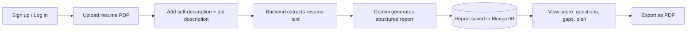

# 🎯 AI Interview Preparation & Resume Platform

**Turn any resume and job description into a personalized interview game plan.**

Match scoring · Tailored interview questions · Skill-gap analysis · Day-wise prep roadmap · PDF reports


[Live Demo](#) · [Report a Bug](../../issues) · [Request a Feature](../../issues)

---

## 📑 Table of Contents

- [Overview](#-overview)
- [Features](#-features)
- [Screenshots](#-screenshots)
- [Tech Stack](#-tech-stack)
- [How It Works](#-how-it-works)
- [Architecture](#-architecture)
- [Project Structure](#-project-structure)
- [Getting Started](#-getting-started)
- [Environment Variables](#-environment-variables)
- [API Reference](#-api-reference)
- [Security](#-security)
- [Deployment](#-deployment)
- [Roadmap](#-roadmap)
- [Contributing](#-contributing)
- [License](#-license)
- [Author](#-author)

---

## 📌 Overview

Interview preparation is often generic: candidates practice common questions without knowing what a specific employer will care about. This platform closes that gap.

Upload your resume, paste a target job description, and add a short self-description. The application uses **Google Gemini** to analyze how well you fit the role and generates a structured, saved **interview report** containing a match score, technical and behavioral questions with sample answers, a skill-gap breakdown, and a day-by-day preparation plan, all exportable as a PDF.

---

## 🚀 Features

| Feature                     | Description                                                             |
| --------------------------- | ----------------------------------------------------------------------- |
| 🧠 **AI Resume Analysis**   | Evaluates your resume against a specific job description.               |
| 📊 **Job Match Score**      | Quantifies how closely your profile aligns with the target role.        |
| 💻 **Technical Questions**  | Role-specific questions with explanations and sample answers.           |
| 🤝 **Behavioral Questions** | HR and situational questions to prepare for culture-fit rounds.         |
| 🔍 **Skill Gap Analysis**   | Highlights missing or weak skills, categorized by severity.             |
| 🗓️ **Preparation Plan**     | A personalized, day-wise roadmap leading up to your interview.          |
| 🔐 **Authentication**       | Secure registration, login, and logout using JWT and HTTP-only cookies. |
| 🗂️ **Report Management**    | Generate, view, retrieve, and delete saved interview reports.           |
| 📄 **PDF Export**           | Download any interview report as a polished PDF.                        |
| 📱 **Responsive UI**        | Clean, modern interface that works across devices.                      |

---

## 🖼️ Screenshots

> Add screenshots to a `docs/screenshots/` folder and update the paths below.

| Dashboard                                    | Interview Report                       |
| -------------------------------------------- | -------------------------------------- |
|  |  |

---

## 🛠️ Tech Stack

**Frontend**

- React.js, JavaScript (ES6+), HTML5, CSS3
- Axios for API communication
- Vite as the build tool and dev server

**Backend**

- Node.js and Express.js
- MongoDB with Mongoose
- JWT authentication and `bcryptjs` for password hashing
- Multer for file uploads
- `pdf-parse` for resume text extraction
- Puppeteer for PDF report generation

**AI Integration**

- Google Gemini via the Google GenAI SDK
- Zod and `zod-to-json-schema` for validated, structured AI output

---

## ⚙️ How It Works



1. **Authenticate** by creating an account or logging in.
2. **Upload** your resume as a PDF.
3. **Provide context** with a self-description and the target job description.
4. **Extract and analyze:** the backend parses the resume and sends the relevant content to Gemini.
5. **Validate:** the AI response is constrained to a Zod schema so the report is always well-structured.
6. **Save and review:** the report is stored in MongoDB and displayed in the UI.
7. **Export** the report as a PDF whenever you need it.

---

## 🏗️ Architecture

```text
┌──────────────┐    HTTPS / JSON    ┌────────────────────┐
│  React (UI)  │ ─────────────────► │  Express REST API  │
└──────────────┘                    │  Auth · Reports    │
                                    └─────────┬──────────┘
                     ┌────────────────────────┼─────────────────────────┐
                     ▼                        ▼                         ▼
              ┌────────────┐          ┌───────────────┐         ┌───────────────┐
              │  MongoDB   │          │ Google Gemini │         │   Puppeteer   │
              │ (Mongoose) │          │ (structured   │         │ (PDF render)  │
              └────────────┘          │    output)    │         └───────────────┘
                                      └───────────────┘
```

---

## 📁 Project Structure

> The structure below is illustrative. Adjust it to match your repository.

```text
Resume-Interview-Platform/
├── Frontend/
│   ├── public/
│   ├── src/
│   ├── package.json
│   └── ...
│
├── Backend/
│   ├── src/
│   │   ├── config/        # Database and environment configuration
│   │   ├── controllers/   # Request handlers
│   │   ├── middlewares/   # Auth, file upload, error handling
│   │   ├── models/        # Mongoose schemas
│   │   ├── routes/        # API route definitions
│   │   └── services/      # AI, PDF parsing, and PDF generation logic
│   ├── server.js
│   ├── package.json
│   └── ...
│
└── README.md
```

---

## 💻 Getting Started

### Prerequisites

- [Node.js](https://nodejs.org/) (LTS recommended) and npm
- A [MongoDB](https://www.mongodb.com/) database (local or Atlas)
- A [Google Gemini API key](https://aistudio.google.com/app/apikey)
- Git

### 1. Clone the repository

```bash
git clone https://github.com/<your-username>/<your-repository>.git
cd <your-repository>
```

### 2. Set up the backend

```bash
cd Backend
npm install
```

Create a `.env` file in the `Backend` directory (see [Environment Variables](#-environment-variables)), then start the server:

```bash
npm start
```

Or, if a development script is configured:

```bash
npm run dev
```

### 3. Set up the frontend

In a new terminal:

```bash
cd Frontend
npm install
npm run dev
```

Open the local URL printed by Vite in your terminal (typically `http://localhost:5173`).

---

## 🔑 Environment Variables

Create `Backend/.env` with the following:

```env
PORT=3000
MONGO_URI=your_mongodb_connection_string
JWT_SECRET=your_strong_jwt_secret
GOOGLE_GENAI_API_KEY=your_gemini_api_key
```

| Variable               | Required | Description                                      |
| ---------------------- | :------: | ------------------------------------------------ |
| `PORT`                 |    No    | Port the API server listens on (default `3000`). |
| `MONGO_URI`            |   Yes    | MongoDB connection string.                       |
| `JWT_SECRET`           |   Yes    | Long, random secret used to sign JWTs.           |
| `GOOGLE_GENAI_API_KEY` |   Yes    | API key for Google Gemini.                       |

> ⚠️ **Never commit your `.env` file or expose API keys.** Make sure `.env` is listed in `.gitignore`.

---

## 📡 API Reference

> Example endpoints are shown below. Update paths and methods to match your actual routes.

**Authentication**

| Method | Endpoint             | Description                        |
| ------ | -------------------- | ---------------------------------- |
| `POST` | `/api/auth/register` | Create a new account.              |
| `POST` | `/api/auth/login`    | Log in and receive an auth cookie. |
| `GET`  | `/api/auth/logout`   | Log out and clear the auth cookie. |

**Interview Reports** (authentication required)

| Method   | Endpoint                 | Description                                |
| -------- | ------------------------ | ------------------------------------------ |
| `POST`   | `/api/interview`         | Upload a resume and generate a new report. |
| `GET`    | `/api/interview`         | List all of the user's reports.            |
| `GET`    | `/api/interview/:id`     | Retrieve a single report.                  |
| `DELETE` | `/api/interview/:id`     | Delete a report.                           |
| `POST`   | `/api/interview/:id/pdf` | Generate a PDF of the report.              |

---

## 🔐 Security

- Passwords are hashed with `bcryptjs`.
- Authentication uses JWTs stored in **HTTP-only cookies**, keeping tokens out of reach of client-side JavaScript.
- Protected routes verify the user's token before granting access.
- Secrets and credentials are stored in environment variables.

**Production checklist**

- Serve the app over **HTTPS**.
- Set cookies with `secure`, `httpOnly`, and an appropriate `sameSite` value.
- Restrict **CORS** to your trusted frontend origin(s).
- Validate and limit uploaded file types and sizes.

---

## 🌐 Deployment

| Layer    | Suggested Service                              |
| -------- | ---------------------------------------------- |
| Frontend | [Vercel](https://vercel.com/)                  |
| Backend  | [Render](https://render.com/)                  |
| Database | [MongoDB Atlas](https://www.mongodb.com/atlas) |

Before deploying:

1. Add all environment variables in each platform's dashboard.
2. Point the frontend's API base URL to your deployed backend.
3. Update CORS and cookie settings for your production domains.
4. Confirm Puppeteer is supported on your backend host (some platforms require extra configuration or a Chromium build).

---

## 🔮 Roadmap

- [ ] Resume templates and customizable formatting
- [ ] Detailed resume feedback and improvement suggestions
- [ ] AI-driven mock interviews with feedback
- [ ] Interview performance tracking over time
- [ ] Report downloads in additional formats
- [ ] Analytics and personalized learning recommendations

---

## 🤝 Contributing

Contributions, issues, and feature requests are welcome.

1. Fork the repository.
2. Create a feature branch: `git checkout -b feature/your-feature`
3. Commit your changes: `git commit -m "Add your feature"`
4. Push to the branch: `git push origin feature/your-feature`
5. Open a Pull Request.

---

## 📄 License

This project is available for educational and portfolio purposes. If you plan to distribute it, add a `LICENSE` file (for example, [MIT](https://choosealicense.com/licenses/mit/)) and update this section.

---

## 👨‍💻 Author

**Kunal Khairnar**

- GitHub: [@your-username](https://github.com/your-username)
- LinkedIn: [Your Name](https://www.linkedin.com/in/your-profile)

⭐ If you found this project helpful, consider giving it a star!
